# Lahore House Price Prediction

An end-to-end machine-learning pipeline that estimates the **asking price of houses in Lahore** from public Zameen.com listing data. It cleans the data with fixed rules, engineers location and size features without leaking the target, compares **five regression models** (including **XGBoost**), tunes them with **5-fold cross-validation**, tracks every experiment in **MLflow**, and explains the main price drivers and where the model is wrong.

## Highlights

- **Leakage-safe features:** location target encodings are computed out-of-fold; test data is touched once.
- **16 engineered features:** size ratios, distance to city landmarks, neighbourhood flags, location frequency and smoothed location price statistics.
- **Five models compared:** Ridge (baseline), Random Forest, Gradient Boosting, XGBoost, SVR.
- **Honest model selection:** the best model is chosen by cross-validation score, never by test score.
- **Full experiment tracking:** every comparison, tuning trial and final evaluation is logged to MLflow (a local SQLite database, no server needed).
- **Explainability and error analysis:** grouped permutation importance, error by price band, area and location, plus a table of the worst predictions.
- **Tested:** 20 unit tests covering parsing, cleaning, feature engineering, encoder leakage, metrics and every model.

## Pipeline

```mermaid
flowchart LR
    A[Zameen CSV] --> B[Standardise columns, parse area and price]
    B --> C[Lahore houses for sale]
    C --> D[Rule-based bounds and de-duplication]
    D --> E[80/20 split stratified by price]
    E --> F[Stateless features]
    F --> G[Pipeline: impute, scale, location encoders]
    G --> H[log price target, 5 models]
    H --> I[5-fold CV and random search, logged to MLflow]
    I --> J[Best model by CV score]
    J --> K[One evaluation on the test set]
    K --> L[Importance and error analysis]
```



## Data

This project uses a **public Zameen.com dataset**; it does not scrape the website. Good sources (search by name; check each dataset's license and terms and cite it):

- Kaggle: *Zameen.com Property Data Pakistan* and *House Prices 2023 Dataset* (both derived from Zameen.com listings)
- Open Data Pakistan: *Property Data for Pakistan* (opendata.com.pk)

Save the CSV as `data/raw/zameen.csv`. The loader adapts to the common column layouts (area as text such as "5 Marla" or as square feet; price as a number or text such as "PKR 1.2 Crore").

What the data is, and is not:

- **Asking prices**, not final sale prices. Listings are often negotiated down.
- **A snapshot in time.** Property prices move, so a model trained on old listings will be off for today's market. The listing year is included as a feature, but check the date range in `data/processed/stats.json`.
- Zameen's marla is taken as 225 sq ft and a kanal as 20 marla.

**Cleaning** keeps Lahore, for-sale houses, then applies fixed rules (not percentiles, so the test set is not made artificially easy): price 10 lakh to 300 crore, area 2 to 200 marla, 1 to 15 bedrooms, price per sq ft between PKR 500 and 150,000; duplicates are removed. Every step's row count is saved to `data/processed/stats.json`.

## Quick start

```bash
git clone https://github.com/muhammadammar5/Lahore-House-Price-Prediction-.git
cd Lahore-House-Price-Prediction-
python -m venv .venv
source .venv/bin/activate        # Windows: .venv\Scripts\activate
pip install -r requirements.txt

# put your CSV at data/raw/zameen.csv, then:
python -m src.data               # clean and split
python -m src.eda                # exploratory plots (training split only)
python -m src.train              # compare, tune, evaluate (about 20-40 min on CPU)
python -m src.analyze            # feature importance and error analysis
mlflow ui --backend-store-uri sqlite:///mlflow.db     # browse every experiment
```

Add `--fast` to `python -m src.train` for a 2-minute smoke test. A Colab notebook is in `notebooks/run_on_colab.ipynb`.

Predict one house:

```bash
python -m src.predict --location "DHA Defence" --area 10 --unit marla --bedrooms 4 --baths 4
```

## Features

| Group | Features |
|---|---|
| Raw | area_sqft, bedrooms, baths, latitude, longitude, listing_year |
| Size and rooms (stateless) | log_area, area_marla, baths_per_bed, area_per_bed, total_rooms, bed_bath_gap, is_kanal_plus |
| Geography (stateless) | dist_center_km, dist_liberty_km, has_coords |
| Neighbourhood flags (stateless) | is_dha, is_bahria, is_premium_area |
| Location statistics (learned on training data only) | location_freq, loc_te_log_price, loc_te_log_ppsf |

Landmark coordinates are approximate. Invalid or placeholder coordinates (such as 0,0) become missing and are imputed.

## Method

- **Target:** models learn `log(1 + price)` and predictions are converted back to PKR, so errors are relative rather than dominated by luxury homes.
- **Cross-validation and tuning:** 5-fold CV on the training split; randomized search optimising RMSLE (log-scale error).
- **Baseline:** Ridge regression. "RMSE reduction" below is measured against it.
- **Metrics:** RMSE and MAE in PKR; R² in PKR and on the log scale; RMSLE; median absolute percentage error (typical % error per house).

## Results

> Fill these in from `results/test_metrics.csv` and `results/analysis_summary.json` after your run. Do not quote numbers you did not measure.

**Cross-validation and test set** (train rows: _TBD_, test rows: _TBD_)

| Model | CV RMSLE | Test RMSE (PKR) | Test R² | Test R² (log) | Median abs % error |
|---|---|---|---|---|---|
| Median predictor | n/a | _TBD_ | _TBD_ | _TBD_ | _TBD_ |
| Ridge (baseline) | _TBD_ | _TBD_ | _TBD_ | _TBD_ | _TBD_ |
| Random Forest | _TBD_ | _TBD_ | _TBD_ | _TBD_ | _TBD_ |
| Gradient Boosting | _TBD_ | _TBD_ | _TBD_ | _TBD_ | _TBD_ |
| XGBoost | _TBD_ | _TBD_ | _TBD_ | _TBD_ | _TBD_ |
| SVR | _TBD_ | _TBD_ | _TBD_ | _TBD_ | _TBD_ |

Best model by cross-validation: _TBD_. MLflow runs logged: _TBD_.

**Main price drivers** (from `results/importance_by_group.csv`): _TBD_


### Reading the results honestly

- **Which R² is it?** R² in PKR is dominated by the few most expensive houses; R² on the log scale reflects accuracy across all prices. Always state which one you quote.
- **A gain over the baseline is not guaranteed.** On some data a well-tuned linear model on log price is hard to beat by much. Report what you measured.
- **Random split, not time split.** Test listings come from the same period as training listings, so real-world error on future prices will be higher.
- Differences between close models are within cross-validation noise (see the `_std` columns in `results/cv_comparison.csv`).

## Project structure

```
src/
  config.py      paths, bounds, constants
  data.py        load, standardise, clean, split
  features.py    feature engineering and leakage-safe encoders
  models.py      model zoo and search spaces
  metrics.py     RMSE, RMSLE, R2 (PKR and log), median % error
  train.py       compare, tune, evaluate, MLflow logging
  analyze.py     importance and error analysis, figures
  eda.py         exploratory plots
  predict.py     CLI price estimate
tests/           20 unit tests
results/         metrics tables (commit these)
figures/         plots (commit these)
notebooks/       Colab runner
```

## Tests

```bash
pytest
```

## Limitations and future work

- Asking prices from one snapshot; no information on condition, age, floors, furnishing or street.
- Location is a free-text area name from the listing; sub-areas inside big societies are not resolved.
- Ideas: time-based split, quantile regression for price ranges, SHAP explanations, a Streamlit app, and a model per price segment.

## License

MIT. Check the license of the dataset you use.
